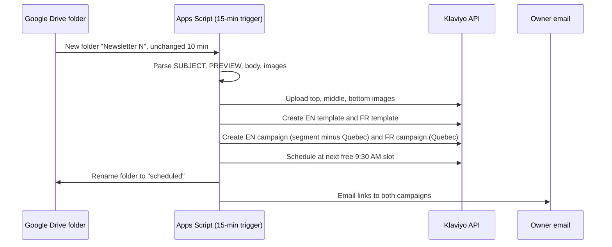

# 01 · Email automation and consent gates

## 1. The problem and who it's for

Gym Army's list was built from e-commerce buyers and browsers, and the LockedIn app needed to reach that list without burning the sending domain. The goal was two things: a consistent daily touchpoint that a non-technical team could run, and a set of gates that stopped any one send from hurting domain reputation.

* **Audience:** the Gym Army mailing list (about 8,500 profiles with a valid email).
* **Owner:** me, with the rule that nothing new gets sent to a cold segment without the gates passing.

## 2. How it works

**Daily newsletter (live since 9 Oct 2026).** The owner drops a folder in Google Drive containing a Doc (SUBJECT, PREVIEW, body, a `[MIDDLE]` marker, and a CTA line) plus three images. A 15-minute Apps Script trigger does the following:



Design decisions:

* **Day N = Newsletter N.** Whoever is on the list on a given day gets that day's issue. I dropped a replay flow because Klaviyo's API can't edit an existing flow, and the replay would have needed hand edits for every issue.
* **Separate EN and FR campaigns** by segment (Quebec, casual "tu"). FR is hand-translated for Issues 1–4, machine-translated after that unless a FR - Doc exists.
* **Dry run first.** A dryRun mode parses every pending folder and touches nothing. This is how a line-break bug in SUBJECT parsing was caught before a live send.

**Reactivation sends (Aug–Sep 2026).** A set of audience-split campaigns to opener and purchaser pools, using the strategies below. Each was built with suppression lists (unsubscribes, bounces, spam complaints) applied before the send.

| Strategy | What it was | Measured result |
| --- | --- | --- |
| Scarcity / hype | "1,000 spots gone in a week" to warmest openers (B1.1) | 5.18% unsubscribe, the highest of any send. The 1,000 figure couldn't be verified, so I shouldn't repeat it. |
| Guilt / identity | "What we forgot to include in your order is the part that gets you to stay true to your goals" (purchasers) | 0.75% click on the next send. Purchasers responded more than visitors throughout. |
| Bait / curiosity | "it was never about the dumbbells" (visitors) | 0 clicks from 552 sends. Blank preheader plus badges-only CTA probably hurt it. |
| Purchase-history targeting | Purchasers (B4 Purchasers, Warehouse variant) | 15.3% click, the best result of the program. About 9x the visitors segment on the same day. |
| Fatigue test | Same audience, four sends in 14 days | Unsubscribes rose and opens fell across the program. Sending too often caused it. |

**Consent and deliverability gates.** Every send goes through these checks before it leaves:

* Recipients come from a list built after removing unsubscribes, bounces and downloaders, so the pool is scrubbed before it is built.
* Smart Sending off on owned campaigns, so a send isn't silently delayed or redirected.
* Sender set at message level, never the account default, to avoid changing reply routing for other flows.
* Bounce below 2%, spam below 0.1%, click rate used as the gate (opens are inflated by Apple Mail Privacy Protection).

## 3. Volume, in numbers

| Metric | Value | Source |
| --- | --- | --- |
| Profiles in the newsletter segment | 8,531 | Klaviyo, 9 Oct |
| Recipients per issue (EN / FR) | about 6,800 / 990 | Segment counts |
| Issues shipped | 4 measured (9–12 Oct), running daily since | Klaviyo campaign list |
| Repeat openers across Issues 1–4 | 1,136 profiles with 2 or more opens (409 opened all four) | Klaviyo K-SQL |
| Reactivation sends (all batches) | about 8,400 sends, roughly 20 campaigns | Klaviyo reports |
| Deliverability baseline | Domain was past Gmail's 0.30% spam threshold in one measured cell during the B4–B5 run | Klaviyo, 2 Sep |

Note on opens: Apple Mail auto-opens about 116 of the 1,136 repeat openers (iCloud, me.com, mac.com), and some are relay or security scanner addresses. Treat the 4/4 tier as an upper bound.

## 4. Redacted sample output

Repeat-opener export (columns and first rows, addresses masked):

```
email,issues_opened_count,issues
***@***.com,4,1-2-3-4
***@***.com,4,1-2-3-4
***@***.ca,2,1-3
***@***.com,3,1-2-4
```

Apps Script run log (one issue, values redacted):

```
[processNewsletters] folder "Newsletter 4" settled 10 min
  images: top ok, middle ok, bottom ok
  template EN: created  template FR: created
  campaign EN -> segment <Everyone> (minus Quebec): scheduled Mon 9:30 ET
  campaign FR -> segment <Quebec FR> (Quebec):   scheduled Mon 9:30 ET
  folder renamed "scheduled", owner emailed
```

## 5. What broke, and what I'd rebuild differently

**What broke**

* **Initial mass sends lacked segmentation.** When I first started the newsletters and app promotions, campaigns went out as large mass sends rather than segment-sized ones. The content was general for most people, and conversion was not promising.
* **Batch 4–7 went out after a stop recommendation.** Four consecutive sends to exhausted audiences cost unsubscribes and some reputation on a domain that carries the store's order emails.
* **Vanity fields in the copy.** A "1,000 spots" claim and an unsourced stat went out in campaigns. Neither could be verified.
* **Klaviyo's API can't edit a flow.** That ruled out the replay design and forced the simpler day-based design.
* **Attribution gaps.** There is still no reliable link from a Shopify order back to the specific email or newsletter touchpoint that produced it.

**What I'd rebuild / what I did to fix it**

1. I started breaking the large population into sub-categories so I could target them based on their niche. This includes recent orders, customers who recently reached out for customer service, location, and repeat customers. Eventually I also ran form-based campaigns where receivers engage with an email that gives us information about who they are, creating even more sub-categories. This allowed new angles of attack. Over time the campaigns and newsletters became more of a conversation between me and the customers/users rather than pure email marketing.
2. A pre-send check: bounce rate of the source list, a spam-complaint trend, and a blocked-claim list (no unverifiable numbers).
3. Suppression applied at list build, not at send time.
4. Order attribution by a coupon code or tagged link per campaign so email-driven activity can be measured more cleanly.
