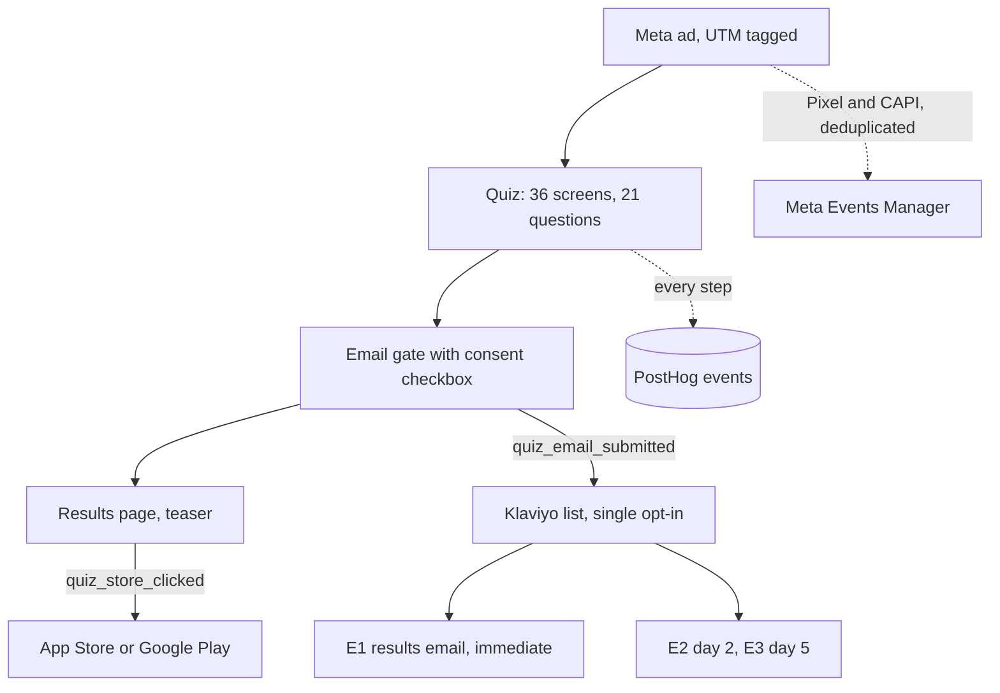

# 02 · Paid quiz funnel

## 1. The problem and who it's for

LockedIn is free, so a paid campaign has to earn an install rather than a sale. The question was whether a Meta ad could bring people who would finish a diagnostic and give an email, so that I could nurture them into the app.

- **Audience:** cold Meta audience in Canada. The quiz is a structured diagnostic (Focus, Energy, Discipline).
- **Output I care about:** quiz completion, email capture, and store taps, not clicks. Clicks are cheap.

## 2. How it works



Build choices:
- **Quiz built in Lovable** as a config-driven flow, so each screen is data rather than code. It has an email step, results page, and store CTA.
- **Meta Pixel plus Conversions API**, deduplicated with an event ID, firing PageView, ViewContent, QuizStart, Lead, QuizComplete and StoreClick. The `?test=1` flag is meant to skip Meta events so my own runs don't train the algorithm. I haven't confirmed it does, so it's an open item.
- **Consent.** Everyone who submits gets the results email (E1). Only people who tick the CASL box go on the consented list that receives the day 2 and day 5 emails.
- **Nurture.** A triggered flow, never a broadcast. Quiz leads never enter e-commerce segments (an exclusion on the engaged-customer segment).

## 3. Volume, in numbers

Window: 29 Sep to 29 Oct 2026, PostHog, excluding events tagged `is_test`.

| Stage | Count | Notes |
|---|---|---|
| Quiz starts | 534 | PostHog, excluding `is_test` |
| Completed results | 388 | |
| Email captures | 313 | |
| Store taps | 116 | |
| Ad spend, lead campaign ("ADHD Quiz") | $324.19, 141 leads, $2.29 per lead | Meta Ads Manager, 29 Sep–28 Oct 2026. Meta's self-reported Website Leads, optimized for Lead. 10,773 impressions, 5,685 reach. |
| Ad spend, traffic campaign (C2) | $298.49, 1,288 landing page views, $0.23 per view | Meta Ads Manager, 29 Sep–28 Oct 2026. Optimized for landing page views, not leads. 33,606 impressions, 21,557 reach. Sends to the quiz only. Now off. |
| Total quiz spend, cost per email capture | $622.68, about $1.99 per email capture | Derived: both campaigns' Meta spend divided by the 313 PostHog email captures above. The windows differ by one day. |

Meta's lead count is for optimization only. Klaviyo is the source of truth for leads (see [the measurement layer](../05-measurement-layer/)). The Meta window ends 28 Oct, one day before the PostHog window.

The PostHog dashboard, *LockedIn Quiz – Funnel & Ads*, shows the funnel, drop-off by screen, and results by `utm_content`.

## 4. Redacted sample output

Funnel rows (one variant, counts only):

```
variant          step_viewed  started  completed  email_submitted  store_click
Free Focus Test  8,106        263      169        120 people       7
Sign Post        931          29       22         16               0
```

Event payload shape (values redacted):

```json
{
  "event": "quiz_email_submitted",
  "properties": {
    "app": "lockedin_quiz",
    "$host": "quiz.gymarmy.app",
    "utm_source": "meta",
    "utm_campaign": "ADHD Quiz",
    "utm_content": "<variant label>",
    "is_test": false,
    "consent_casl": true
  }
}
```

## 5. What broke, and what I'd rebuild differently

**What broke**
- **An unresolved template macro.** Some traffic arrived with the literal `{{ad.name}}` in `utm_content`, so a few leads can't be attributed to an ad. The UTM macro in the ad template was wrong on at least one ad.
- **A suspicious variant.** One variant shows about 830 people seeing a step but 12 starting. I haven't confirmed whether that's a broken first screen, bot or preview traffic. I'm not drawing a conclusion until I've checked.
- **Test traffic in production events.** Test runs reached PostHog and Meta before I added `?test=1` handling. That skewed early numbers.
- **Email gate placed before value.** The first version asked for an email before showing any result. The later version shows a teaser first. I'd test that order on purpose rather than guess.
- **Attribution gaps.** There is no reliable post-purchase link tying a quiz-driven install or store tap back to a specific ad or email nurture sequence, so true "installs per order" or quiz ROI remains unmeasurable beyond the immediate funnel.

**What I'd rebuild**
1. Pixel and CAPI test mode isolated from production, by default.
2. A reconciliation check that flags any `utm_content` that doesn't match the ad registry.
3. A/B the email gate position with a fixed sample size instead of changing it mid-flight.
4. Coupon or unique referral codes in the nurture emails so downstream orders can be attributed back to the quiz funnel.
