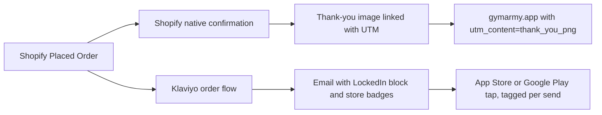
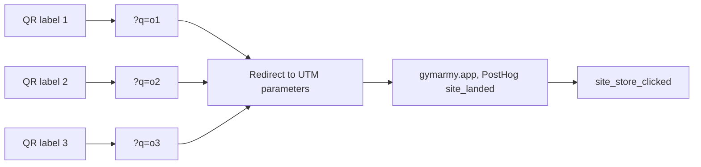

# 03 · Order and QR touchpoints

## 1. The problem and who it's for

Gym Army ships a physical product (adjustable dumbbells) to customers who are already committed to training at home. That's a warm audience at the exact moment they're thinking about fitness. The problem: a DTC brand has two easy touchpoints (the order confirmation and the box), and neither was pointing at the app.

- **Audience:** every Gym Army buyer, in Canada and the US.
- **Two channels:** the order confirmation email (every order) and QR codes on outside shipment labels.

## 2. How it works

**Order confirmation.** Shopify sends its native confirmation. A Klaviyo flow sends a second email, carrying the LockedIn block, when the Placed Order metric fires. Both are needed because Shopify's email reaches unsubscribed buyers and Klaviyo's does not.



Design decisions:

- **Non-transactional marketing email.** It has a "free offer" band and store badges, so Klaviyo would reject it as transactional. That means unsubscribed buyers don't get it, and I accept that trade-off.
- **Tagged store links.** Every store link carries its own ct= or referrer= value (order_conf_email, order_conf_shopify). I never reuse a link copied from a received email, because that ships one person's tracking token to everyone.
- **One flow only.** A draft second flow was left in place for a while, and I found it would have doubled the emails. Only one Placed Order flow is live.

**QR codes on outside labels.** Three QR codes, each on a different outside label. Each points to a short link (`gymarmy.app/?q=o1`, `o2`, `o3`) that maps to UTM parameters (`utm_source=box`, `utm_medium=qr`, `utm_campaign=box_outside`, `utm_content` per label). PostHog captures the landing and every badge tap.



## 3. Volume, in numbers

| Metric | Value | Source |
| --- | --- | --- |
| Order-email sends in 90 days (Klaviyo flow) | 114 | Klaviyo, before the redesign |
| Order-email open rate / click rate | 64% / 4.4% | Klaviyo, before the redesign |
| QR labels live | 3 | Shipment labels |

| Label | Boxes sent | Scanned | Downloaded | Scan rate | Downloads per scan |
| --- | --- | --- | --- | --- | --- |
| Label 1 | about 50 | 45 | 20 | about 90% | 44% |
| Label 2 | 55 | 31 | 19 | 56% | 61% |
| Label 3 | 55 | 43 | 26 | 78% | 60% |
| Total | about 160 | 119 | 65 | about 74% | 55% |

The rows above count identified visitors only, for 14–29 Oct. This table counts every scan over the full 1.5 months.

Label 1 had the highest scan rate (about 90%). Labels 2 and 3 turned more scans into downloads (about 60%). With 50 to 55 boxes per label, that is a first read, not a winner.

## 4. Redacted sample output

Klaviyo flow report row (values redacted):

```
flow: Order Confirmation - Standard   trigger: Placed Order
message: Order email (LockedIn block)  sends_90d: 114   open: 64%   click: 4.4%
```

Store link, as used in the Shopify template (tag names only):

```
https://apps.apple.com/us/app/lockedin-build-discipline/id…?ct=order_conf_shopify
https://play.google.com/store/apps/details?id=…&referrer=utm_source%3Dshopify%26utm_medium%3Demail%26utm_campaign%3Dorder_conf
```

## 5. What broke, and what I'd rebuild differently

**What broke**

- **A stale block in Shopify's template.** An old "Workout Tracker" promo was baked into Shopify's notification template, not Klaviyo's. Editing Klaviyo didn't remove it.
- **A flow edit mid-send.** I swapped the template while a test order was triggering it, and that order missed the new version. That was my timing error, not a system failure, but it's a rule now: never edit a live flow during a test.
- **Event lag misread as failure.** Klaviyo's "Received Email" events arrive minutes late. I briefly concluded the email wasn't sending. Check the inbox before concluding anything.
- **The QR test is still small.** About 160 boxes across three labels is enough to see a pattern, not to call a winner. The label differences could still be noise.
- **Attribution gaps.** There is still no link from a Shopify order back to the specific order-email or QR touchpoint that produced a subsequent install or repeat order, so "installs per order" cannot be measured.

**What I'd rebuild**

1. One owner for the confirmation experience: a single email with a clear split between transactional content (order details) and marketing content (LockedIn), so it can be approved and sent to everyone.
2. Store links generated by one function, never pasted.
3. A QR label plan with a volume target before the test starts, and a pre-registered result rule (what counts as a winner, at what sample size).
4. Unique coupon codes or tagged links per touchpoint so orders can be attributed back to the order email or QR scan.
