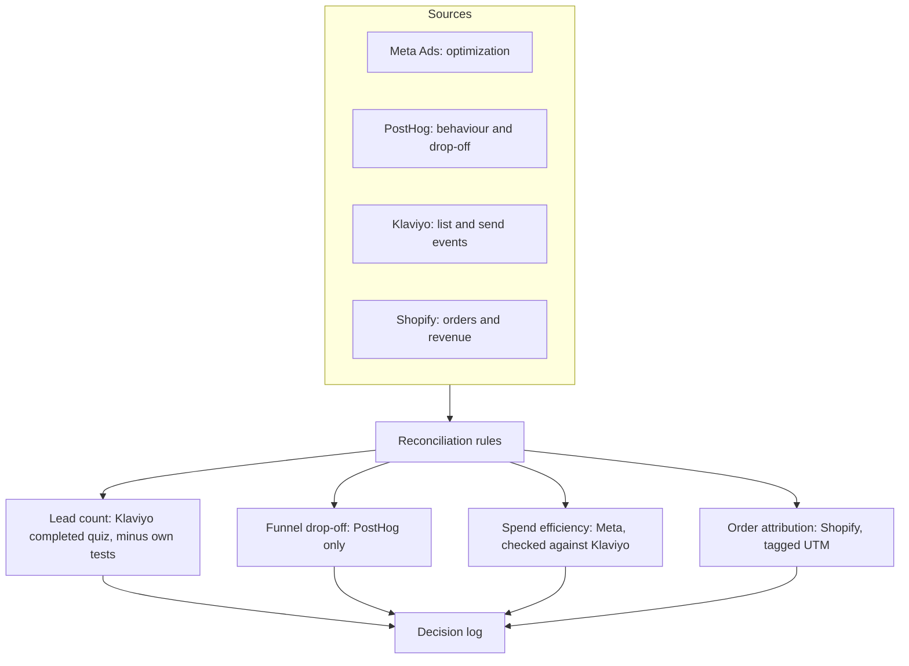

# 04 · Measurement layer

## 1. The problem and who it's for

Every system above reports its own numbers. Meta says it had 3 leads, PostHog says 2 people, and Klaviyo counts a third set. None of them is wrong, and none of them is the answer. The job of this layer is to make the numbers agree on definitions, record which one to trust for which question, and flag the places where they can't.

* **Audience:** me, and anyone who reads a number from this business and wants to know what it means.

## 2. How it works



Core conventions:

* **One event taxonomy per product**, prefixed by surface (quiz_, site_, bet_), with a super property app and a $host filter. Preview domains are excluded by host.
* **is_test on every event.** Test runs are tagged so they can be filtered. Where I couldn't confirm the tag stops Meta events, I've written that down rather than assuming.
* **Source of truth by question.** Meta is for optimization, PostHog for drop-off, Klaviyo for leads, Shopify for money. A number from one system is never presented as a number from another.
* **Cohort pulls from Klaviyo** using its analytics query tool. Per-profile open counts, grouped into tiers, with the Apple Mail caveat written beside each tier. Detail queries are capped at 1,000 rows, so large tiers need separate queries.
* **Per-recipient event pulls** by time window, in parallel, to a local file. Verified by matching per-campaign unique counts against the platform's own report.

## 3. Volume, in numbers

| Dataset | Size |
| --- | --- |
| PostHog events, quiz and site (29 Sep–29 Oct) | quiz, site and bet surfaces, filtered by app and $host; exact event count not yet pulled |
| Klaviyo profiles with valid email | 8,304 (Aug) → 8,531 (Oct) |
| Per-campaign open events verified | 1,461 events matched across 13 campaigns, 0 mismatches |
| Repeat-opener tiers built | 4 (1 of 4, 2 of 4, 3 of 4, 4 of 4), 1,136 profiles with 2+ |
| Known reconciliation gaps documented | 4 (lead counts, ad label schemes, unresolved macro, missing post-purchase attribution) |

## 4. Redacted sample output

Reconciliation table, one week (counts only):

```
metric                 meta   posthog   klaviyo   use for
quiz leads             3      2         (see)     klaviyo is source of truth
quiz starts            -      534      -         posthog only
store taps             -      116       -         posthog only
```

Repeat-opener tier output (addresses removed):

```
tier      profiles   note
4 of 4    409        upper bound: includes Apple auto-opens and scanners
3 of 4    332
2 of 4    395
total 2+  1,136
```

Event schema, one event (identifiers removed):

```
event: quiz_step_viewed
  app:        lockedin_quiz
  $host:      quiz.gymarmy.app
  step:       S12
  utm_source: meta
  utm_content: <variant label>
  is_test:    false
```

## 5. What broke, and what I'd rebuild differently

**What broke**

* **Three numbers for one lead.** Meta, PostHog and Klaviyo each counted leads differently, and for the first few days PostHog missed a real lead entirely because it hadn't started tracking yet.
* **Unresolved macros.** A UTM template variable didn't resolve on some traffic. I found it because the values were literal strings in the data.
* **Test traffic in production.** Test runs reached Meta before tagging. Meta's optimization was trained on my own clicks for a short period.
* **Post-purchase attribution gap.** There's no link from a Shopify order back to the touchpoint that produced it, so "installs per order" can't be measured yet.
* **Early mass-send approach.** Initial newsletters and app promotions went out as broad mass sends to large lists rather than targeted segments. Content was general, and conversion was weak until segmentation improved.

**What I'd rebuild**

1. A nightly reconciliation job that flags any metric where the sources disagree by more than a set threshold.
2. Order attribution by a coupon code per channel so orders can be tied back to touchpoints.
3. A decision log: each number I act on is written down with its source and the question it answers.
4. Segment-first campaign design: break lists into niches (recent orders, customer-service contacts, location, repeat customers, and form-based self-identification) so campaigns feel like a conversation rather than a broadcast.
