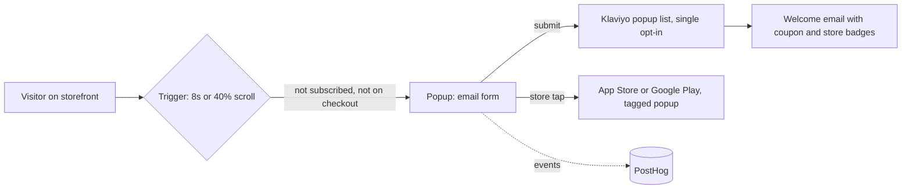

# 04 · Site popup

## 1. The problem and who it's for

The storefront was already getting visitors, and the email popup was offering a discount. The job was to test a different offer: the LockedIn app, as a free distribution channel that teaches me how buyers react. The popup is a way to reach people who would otherwise leave, not a sales offer.

- **Audience:** storefront visitors who aren't yet subscribers.
- **Goal:** submit rate, and a store tap I can trace back to the popup.

## 2. How it works



Build decisions:
- **Single opt-in.** Popup consent counts as express consent under CASL. A double opt-in cost me 4 of 5 real submitters, who never clicked the confirmation email. I switched the list to single opt-in and recorded why.
- **Show rules.** Shows after about 8 seconds or 40% scroll. Hidden from existing subscribers and on cart and checkout pages. Re-shows after 7 days if closed.
- **Old popup kept in draft.** The old $15-off popup and the new popup were both live for a while, so two popups could appear to one visitor. I set the old one to draft.
- **Store links, not email links.** Popup store links carry their own tag and never reuse a link from an email.

## 3. Volume, in numbers

| Metric | Old popup (discount) | New popup (LockedIn app) |
|---|---|---|
| Window | 7 days to 5 Oct | 6 to 7 Oct, first 2 days |
| Views | 681 | not yet reported in full |
| Submits | 6 | 6 (1 was my own test) |
| Submit rate | 0.88% | 4.5% on a small sample (5 real submits) |
| Revenue attributed | $0 | not yet tracked |

Traffic sources for the new popup's submits: 2 from paid Facebook traffic, and the rest from product pages.

Sample size matters. 5 real submits is not a conclusion. I'm reporting it as a first read.

## 4. Redacted sample output

Form submit log, PostHog event view (identifiers removed):

```
event: Submitted Form   form: LockedIn popup   list: single opt-in   confirmed: yes
  source: product page   utm_source: (none)
event: Submitted Form   form: LockedIn popup   list: single opt-in   confirmed: yes
  source: facebook   utm_source: facebook   utm_medium: paid
```

Klaviyo list membership, after the switch to single opt-in:

```
list: LockedIn popup emails
members: all submits counted once, no unconfirmed rows
```

## 5. What broke, and what I'd rebuild differently

**What broke**
- **Double opt-in leaked 4 of 5 submitters.** The list was created with double opt-in, so people who submitted never joined unless they clicked a confirmation email. I found it by comparing the form's submit count against the list's member count.
- **Two popups at once.** The old discount popup stayed published while the new one went live. I set the old one to draft, but for a while the site showed two popups to the same visitor.
- **The form said "Email + Phone" but took only email.** The name was left over from a plan I dropped. Harmless, but it means the form's name doesn't describe the form.
- **The CASL line was missing from the live form.** Without it, the consent basis for single opt-in is weak. I found this in a screenshot review and fixed it.
- **Early numbers.** A 4.5% submit rate on 5 real submits is noise until I have a few hundred views.

**What I'd rebuild**
1. Check opt-in settings on any new list right after creating it, as a required step.
2. One popup live at a time, enforced by the publish checklist.
3. A pre-registered read: sample size and the rule for "better" set before the test, not after.
4. Revenue attribution through the welcome email's coupon code, so the popup is measured on orders and not only on submits.
