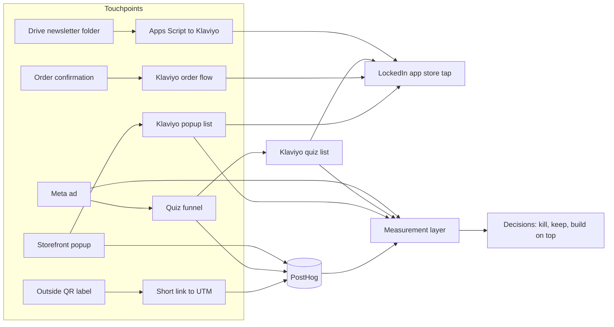

# systems

I build the operational systems that turn raw traffic and customer data into reliable, measurable growth loops — automation, segmentation, multi-tool orchestration, and the measurement layer that tells me which numbers I can trust.

These systems were built and run for **Gym Army** (a DTC fitness equipment brand) and **LockedIn** (its free accountability app). I'm the COO and co-founder of Gym Army, and I build the systems myself in Apps Script, Python, SQL, Klaviyo, Lovable, Meta and PostHog.

This repo is about the systems, not a scorecard. Each system has four parts: how it runs, what it produced, what broke, and how I measure behaviour so I can build on top of it.

## What's proprietary, and why

Gym Army is my company, so I made the call to publish architecture and aggregated outputs. Nothing here contains customer emails or names, order-level data, supplier terms, margins, or API keys. Numbers are rounded or aggregated, and where a number is a platform's self-reported figure, I say so.

## The systems

| # | System | What it does | Volume (as of 29 Oct 2026) |
|---|---|---|---|
| 01 | [Email automation and consent gates](01-email-automation/) | Daily newsletter from a Google Drive folder into Klaviyo, plus reactivation sends with consent and deliverability gates | 8,531 profiles in the newsletter segment. About 6,800 EN and 990 FR recipients per issue. Issues 1–4 measured. Reactivation program: roughly 8,400 sends in total. |
| 02 | [Paid quiz funnel](02-paid-quiz-funnel/) | Meta ads to a 36-screen quiz, email capture, Klaviyo nurture, then App Store and Google Play taps, all tracked in PostHog | 534 quiz starts, 388 completed results, 313 email captures, 116 store taps (29 Sep–29 Oct) |
| 03 | [Order and QR touchpoints](03-order-and-qr-touchpoints/) | LockedIn block in every order confirmation (Shopify plus Klaviyo), and three QR codes on outside shipment labels with short-link to UTM to PostHog attribution | LockedIn block on every order confirmation. QR: about 160 boxes, 119 scans and 65 downloads across 3 labels in about 1.5 months. |
| 04 | [Site popup](04-site-popup/) | Email popup on the Gym Army storefront that offers the LockedIn app as a distribution and learning channel | Submit rate 0.88% on the old offer (7 days, 681 views), 4.5% on the app popup over the first 2 days (6 submits, small sample) |
| 05 | [Measurement layer](05-measurement-layer/) | The event taxonomy, UTM conventions, source-of-truth rules and reconciliation that let me trust (or distrust) the numbers above | 3 platforms reconciled (Meta, PostHog, Klaviyo). 4 known reconciliation gaps documented. |

## How the systems connect

## What I'd tell a reviewer first

- Early newsletters and app promotions started as broad mass sends to large lists. Conversion was weak until I began segmenting by niche (recent orders, customer-service contacts, location, repeat customers) and adding form-based self-identification. The campaigns eventually felt more like a conversation than pure email marketing. The same pattern — single source of truth, hygiene rules, and source-of-truth decisions by question — is what I would apply to a City Launcher CRM and routing system.
- I sent reactivation campaigns to exhausted lists after a stop recommendation. Those numbers are in the repo because I'd rather you see the cost than trust a polished story.
- Attribution gaps remain: there is still no reliable link from a Shopify order back to the specific touchpoint (email, quiz, QR, popup) that produced it, so "installs per order" is unmeasurable across most systems. Closing that gap (coupon codes or unique referrers per channel) is the first measurement layer I would extend so every City Launcher sees cost per signed team by city on one screen.

## What I would build first for a City Launcher playbook

The systems above are the foundation. For a multi-city launch model the same principles apply:

- CRM stages and routing so every new captain inquiry hits a defined path, with a named human approver before any automated reply.
- Launch checklist template that a new launcher in a new city can clone and run on day one, including cities outside North America.
- Weekly scorecard that leadership reads in one screen (signed teams, cost per signed team by city, bottleneck by stage).
- Agents that stay in propose mode until acceptance rate justifies auto mode, each with consent and deliverability gates that fail safe (zero messages if the check fails).
- Source-of-truth rules and a decision log so spend is judged by signed teams, not clicks, and every number used for a decision has a recorded source.
