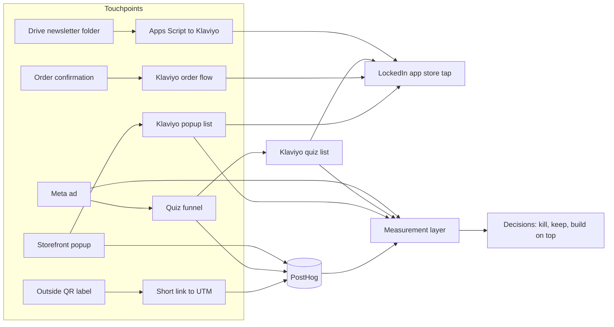

# systems

Growth systems I built and run for **Gym Army** (a DTC fitness equipment brand) and **LockedIn** (its free accountability app). I'm the COO and co-founder of Gym Army, and I build the systems myself in Apps Script, Python, SQL, Klaviyo, Lovable, Meta and PostHog.

This repo is about the systems, not a scorecard. Each system has four parts: how it runs, what it produced, what broke, and how I measure behaviour so I can build on top of it.

## What's proprietary, and why

Gym Army is my company, so I made the call to publish architecture and aggregated outputs. Nothing here contains customer emails or names, order-level data, supplier terms, margins, or API keys. Numbers are rounded or aggregated, and where a number is a platform's self-reported figure, I say so.

## The systems

| # | System | What it does | Volume (as of 29 Oct 2026) |
|---|---|---|---|
| 01 | [Email automation and consent gates](01-email-automation/) | Daily newsletter from a Google Drive folder into Klaviyo, plus reactivation sends with consent and deliverability gates | 8,531 profiles in the newsletter segment. About 6,800 EN and 990 FR recipients per issue. Issues 1–4 measured. Reactivation program: roughly 8,400 sends in total. |
| 02 | [Paid quiz funnel](02-paid-quiz-funnel/) | Meta ads to a 36-screen quiz, email capture, Klaviyo nurture, then App Store and Google Play taps, all tracked in PostHog | About 390 quiz starts, 192 completed results, about 140 email captures across labelled variants, 10 store taps (29 Sep–29 Oct) |
| 03 | [Order and QR touchpoints](03-order-and-qr-touchpoints/) | LockedIn block in every order confirmation (Shopify plus Klaviyo), and three QR codes on outside shipment labels with short-link to UTM to PostHog attribution | About 38 orders a month, each carrying the LockedIn block. QR: about 160 boxes, 119 scans and 65 downloads across 3 labels in about 1.5 months. |
| 04 | [Site popup](04-site-popup/) | Email popup on the Gym Army storefront that offers the LockedIn app as a distribution and learning channel | Submit rate 0.88% on the old offer (7 days, 681 views), 4.5% on the app popup over the first 2 days (6 submits, small sample) |
| 05 | [Measurement layer](05-measurement-layer/) | The event taxonomy, UTM conventions, source-of-truth rules and reconciliation that let me trust (or distrust) the numbers above | 3 platforms reconciled (Meta, PostHog, Klaviyo). 4 known reconciliation gaps documented. |

## How the systems connect

## What I'd tell a reviewer first

- The newsletter auto-schedules with no human approval gate. I'd add a propose mode with a named approver before anything else.
- I sent reactivation campaigns to exhausted lists after a stop recommendation. Those numbers are in the repo because I'd rather you see the cost than trust a polished story.
- One quiz variant accounts for most of the volume. Two ad-label schemes are running side by side, and one ad's UTM macro didn't resolve. I documented these in the measurement layer rather than cleaning them quietly.
